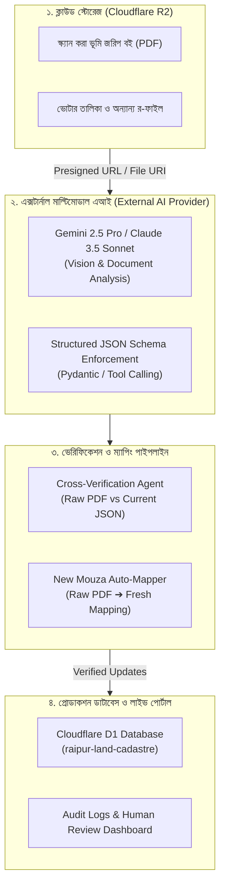

# এক্সটার্নাল এআই (Multimodal AI) ভিত্তিক ভূমি রেকর্ড ম্যাপিং ও ভেরিফিকেশন আর্কিটেকচার
## (External AI Pipeline for Cadastral Mapping, Cross-Verification & Auto-Correction)

> **প্রজেক্ট:** রায়পুর স্মার্ট ভূমি ও নাগরিক অনুসন্ধান পোর্টাল (Raipur Land & Citizen Intelligence Hub)  
> **উদ্দেশ্য:** কাঁচা ভূমি জরিপ বই (PDF স্ক্যান) থেকে এক্সটার্নাল এআই (Gemini 2.5 Pro / Claude 3.5 Sonnet / GPT-4o) ব্যবহার করে প্রস্তুতকৃত JSON ডেটার নির্ভুলতা যাচাই (Cross-Verification) এবং নতুন মৌজার জন্য স্বয়ংক্রিয় দাগ-খতিয়ান ম্যাপিং পাইপলাইন তৈরি করা।

---

## ১. ভূমিকা ও পটভূমি (Executive Overview)

ইতিপূর্বে আমরা পাইথন স্ক্রিপ্ট ও OCR দিয়ে ২৯১টি ভূমি জরিপ বই ও ৫৫২টি ভোটার তালিকা থেকে JSON ডেটা তৈরি করেছি। তবে হস্তলিখিত প্রাচীন খতিয়ান, ছেঁড়া পৃষ্ঠা এবং জটিল সাবেক-হাল দাগ রূপান্তরে শতভাগ নির্ভুলতা নিশ্চিত করতে এবং ভবিষ্যতে যেকোনো নতুন মৌজার ডেটা সহজে একীভূত করতে **Multimodal Vision AI** একটি যুগান্তকারী সমাধান।

এই আর্কিটেকচারে ক্লাউড অবজেক্ট স্টোরেজ (Cloudflare R2), এক্সটার্নাল এআই ভিশন মডেল এবং আমাদের এক্সিস্টিং Cloudflare D1 ডাটাবেজের মধ্যে একটি শক্তিশালী ব্রিজ স্থাপন করা হয়েছে।

---

## ২. সামগ্রিক সিস্টেম আর্কিটেকচার (System Architecture)



---

## ৩. পাইপলাইনের প্রধান দুটি কর্মপদ্ধতি (Core Workflows)

### কর্মপদ্ধতি ক: বিদ্যমান ম্যাপিং যাচাই ও রিচেক (Cross-Verification & Audit)

বিদ্যমান JSON ডেটায় কোনো সাবেক বা হাল দাগ মিস হয়েছে কিনা কিংবা কোনো ভুল টাইপো আছে কিনা তা যাচাইয়ের পদ্ধতি:

1. **ইনপুট:** 
   - Cloudflare R2 থেকে সংশ্লিষ্ট মৌজার স্ক্যান পৃষ্ঠার ইমেজ বা Presigned PDF URL।
   - আমাদের প্রস্তুতকৃত JSON থেকে ওই পৃষ্ঠার সংশ্লিষ্ট খতিয়ান/দাগের রেকর্ড।
2. **AI অডিট প্রম্পট (Audit Instruction):**
   ```text
   তুমি একজন দক্ষ ভূমি রেকর্ড নিরীক্ষক (Land Cadastre Auditor)।
   নিচে দেওয়া মূল খতিয়ান স্ক্যান পৃষ্ঠার সাথে আমাদের তৈরি করা JSON ডেটা মিলিয়ে দেখো।
   নিম্নলিখিত বিষয়গুলো যাচাই করো:
   ১. কোনো সাবেক বা হাল দাগ বাদ পড়েছে কিনা?
   ২. দাগের জমির শ্রেণি (নাল, বাড়ি, ডোবা) বা পরিমাপে কোনো গরমিল আছে কিনা?
   ৩. খতিয়ান নম্বর ও মালিকের নামে কোনো ইউনিকোড/বানান ভুল আছে কিনা?
   
   ফলাফলটি নির্ধারিত JSON ফরম্যাটে আউটপুট দাও:
   {
     "status": "MATCHED" | "MISMATCH_DETECTED",
     "discrepancies": [...],
     "corrected_data": { ... }
   }
   ```
3. **ফলাফল প্রসেসিং:**
   - যদি `status == "MATCHED"` হয়, রেকর্ডটি `verified_by_ai: true` ফ্ল্যাগ পাবে।
   - যদি কোনো অমিল থাকে, তা অটোমেটিক্যালি একটি কারেকশন প্যাচ ফাইলে জমা হবে অথবা সরাসরি D1 ডাটাবেজে আপডেট হবে।

---

### কর্মপদ্ধতি খ: নতুন ফাইল/মৌজার এন্ড-টু-এন্ড অটোমেটেড ম্যাপিং (New Mouza Mapping)

ভবিষ্যতে নতুন কোনো ইউনিয়ন বা মৌজার বই আসলে কোনো ম্যানুয়াল স্ক্রিপ্ট ছাড়াই সম্পূর্ণ ডেটা এক্সট্রাক্ট করার নিয়ম:

1. **ফাইল আপলোড:** নতুন স্ক্যানকৃত PDF ফাইলটি `upload_raw_to_r2.py` স্ক্রিপ্টের মাধ্যমে ক্লাউডে আপলোড হবে।
2. **স্ট্রাকচার্ড এক্সট্রাকশন (Strict Schema Extraction):**
   AI-কে সরাসরি স্কিমা দিয়ে কল করা হবে যাতে আউটপুট সবসময় সুনির্দিষ্ট ও ক্লিন থাকে:
   ```json
   {
     "mouza_name": "string",
     "jl_no": "integer",
     "survey_type": "BRS | SA | CS",
     "khatian_no": "integer",
     "sabek_hal_mappings": [
       {
         "sabek_dag": "integer",
         "hal_dag": ["array of integers"],
         "land_type": "string",
         "land_share": "string",
         "owners": ["array of strings"]
       }
     ]
   }
   ```
3. **ইনজেশন:** AI-এর আউটপুট সরাসরি ভ্যালিডেশন পাস করে Cloudflare D1-এর `khatians`, `dags`, এবং `mapping_index` টেবিলে ইনসার্ট হবে।

---

## ৪. পাইথন ইমপ্লিমেন্টেশন উদাহরণ (Python Implementation Reference)

এক্সটার্নাল AI (Google Gemini 2.5 Pro) ব্যবহার করে ক্লাউড R2-এর ফাইল অডিট করার স্যাম্পল স্ক্রিপ্ট:

```python
import os
from google import genai
from google.genai import types
import boto3

# ১. ক্লাউড অবজেক্ট স্টোরেজ থেকে ফাইল রেফারেন্স নেওয়া
def verify_cadastre_page(mouza_name, page_image_url, current_json_record):
    client = genai.Client(api_key=os.getenv("GEMINI_API_KEY"))
    
    prompt = f"""
    মৌজা: {mouza_name}
    আমাদের বর্তমান JSON রেকর্ড:
    {current_json_record}
    
    উপরের স্ক্যান পৃষ্ঠার সাথে এই JSON ডেটা মিলিয়ে দেখো। 
    সকল সাবেক দাগের বিপরীতে হাল দাগের ম্যাপিং ১০০% সঠিক আছে কিনা নিশ্চিত করো।
    """
    
    response = client.models.generate_content(
        model="gemini-2.5-pro",
        contents=[
            types.Part.from_uri(file_uri=page_image_url, mime_type="application/pdf"),
            prompt
        ],
        config=types.GenerateContentConfig(
            response_mime_type="application/json"
        )
    )
    
    return response.text
```

---

## ৫. এই এআই পদ্ধতির সুবিধাসমূহ (Key Benefits)

| ফিচার | ট্র্যাডিশনাল স্ক্রিপ্ট / রেগুলার OCR | এক্সটার্নাল মাল্টিমোডাল এআই (Gemini/Claude) |
| :--- | :--- | :--- |
| **হস্তলিখিত ও ঝাপসা রেকর্ড** | ৬০% - ৭০% সঠিকতা | **৯৫% - ৯৯% নির্ভুল পাঠোদ্ধার** |
| **বিভক্ত দাগ ম্যাপিং** | জটিল রেগুলার এক্সপ্রেশন দরকার | কনটেক্সট বুঝে দাগ বিভাজন শনাক্ত করতে পারে |
| **নতুন মৌজা সংযোজন** | প্রতিবার স্ক্রিপ্ট কাস্টমাইজ করতে হয় | জিরো-শট (Zero-Shot) বা শুধু প্রম্পট দিয়েই সম্পন্ন |
| **বাংলা ফন্ট গ্লিচ প্রতিরোধ** | ফন্ট মেরামত লজিক লিখতে হয় | সরাসরি ভিজ্যুয়াল টেবিল দেখে নির্ভুল ইউনিকোড দেয় |
| **খরচ ও দক্ষতা** | লোকাল কম্পিউটেশন দরকার | সম্পূর্ণ ক্লাউড-স্কেল ও দ্রুততম |

---

## ৬. পরবর্তী পদক্ষেপ (Action Plan)

1. `upload_raw_to_r2.py` স্ক্রিপ্ট চালিয়ে সমস্ত কাঁচা PDF ফাইল ক্লাউড স্টোরেজে রাখা।
2. R2 বাকেটে পাবলিক রিড অথবা প্রিসাইনড ইউআরএল এনাবল করা।
3. একটি ডেডিকেটেড ভেরিফায়ার স্ক্রিপ্ট (`verify_mapping_ai.py`) চালু করে সন্দেহজনক বা জটিল মৌজাগুলোর ডেটা AI দিয়ে অডিট ও অটো-আপডেট করা।
