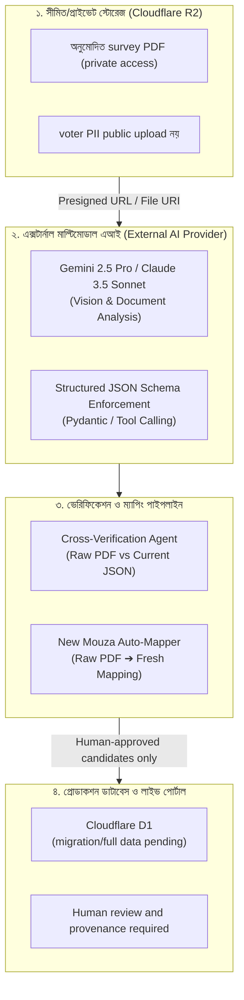

# এক্সটার্নাল এআই (Multimodal AI) ভিত্তিক ভূমি রেকর্ড ম্যাপিং ও ভেরিফিকেশন আর্কিটেকচার
## (Proposed External AI Pipeline for Cadastral Review — No Automatic Correction)

> **প্রজেক্ট:** রায়পুর স্মার্ট ভূমি ও নাগরিক অনুসন্ধান পোর্টাল (Raipur Land & Citizen Intelligence Hub)  
> **উদ্দেশ্য:** কাঁচা ভূমি জরিপ বই (PDF স্ক্যান) থেকে এক্সটার্নাল এআই (Gemini 2.5 Pro / Claude 3.5 Sonnet / GPT-4o) ব্যবহার করে প্রস্তুতকৃত JSON ডেটার নির্ভুলতা যাচাই (Cross-Verification) এবং নতুন মৌজার জন্য স্বয়ংক্রিয় দাগ-খতিয়ান ম্যাপিং পাইপলাইন তৈরি করা।

> **Status / safety:** এটি proposed design, implemented/validated pipeline নয়। PDF-ভিত্তিক audit, AI accuracy benchmark, বা verified cross-survey lineage করা হয়নি। AI output কেবল review candidate; human approval ছাড়া canonical source বা production D1-এ auto-write/correction করা যাবে না। Voter/land PII public R2-তে upload করা যাবে না; private storage and least-privilege access ব্যবহার করতে হবে।

---

## ১. ভূমিকা ও পটভূমি (Executive Overview)

Project inventory-তে ২৯১টি land-survey PDF ও ৫৫২টি voter-list PDF আছে; কিন্তু বর্তমান JSON-এর PDF/page provenance-সহ পুনরুৎপাদনযোগ্য extraction/verification run নিশ্চিত হয়নি। হাতে লেখা/ক্ষতিগ্রস্ত পৃষ্ঠা এবং cross-survey split/merge mapping অনিশ্চিত; **Multimodal Vision AI** সহায়ক review tool হতে পারে, নির্ভুলতার নিশ্চয়তা নয়।

এই নথির architecture Cloudflare R2, external AI ও D1-এর মধ্যে একটি future workflow প্রস্তাব করে; bridge চালু হয়েছে বা D1 পূর্ণ হয়েছে—এমন দাবি নয়।

---

## ২. সামগ্রিক সিস্টেম আর্কিটেকচার (System Architecture)



---

## ৩. পাইপলাইনের প্রধান দুটি কর্মপদ্ধতি (Core Workflows)

### কর্মপদ্ধতি ক: বিদ্যমান ম্যাপিং যাচাই ও রিচেক (Cross-Verification & Audit)

বিদ্যমান JSON ডেটায় কোনো সাবেক বা হাল দাগ মিস হয়েছে কিনা কিংবা কোনো ভুল টাইপো আছে কিনা তা যাচাইয়ের পদ্ধতি:

1. **ইনপুট:** 
   - Cloudflare R2 থেকে সংশ্লিষ্ট মৌজার স্ক্যান পৃষ্ঠার ইমেজ বা Presigned PDF URL।
   - আমাদের প্রস্তুতকৃত JSON থেকে ওই পৃষ্ঠার সংশ্লিষ্ট খতিয়ান/দাগের রেকর্ড।
2. **AI অডিট প্রম্পট (Audit Instruction):**
   ```text
   তুমি একজন দক্ষ ভূমি রেকর্ড নিরীক্ষক (Land Cadastre Auditor)।
   নিচে দেওয়া মূল খতিয়ান স্ক্যান পৃষ্ঠার সাথে আমাদের তৈরি করা JSON ডেটা মিলিয়ে দেখো।
   নিম্নলিখিত বিষয়গুলো যাচাই করো:
   ১. কোনো সাবেক বা হাল দাগ বাদ পড়েছে কিনা?
   ২. দাগের জমির শ্রেণি (নাল, বাড়ি, ডোবা) বা পরিমাপে কোনো গরমিল আছে কিনা?
   ৩. খতিয়ান নম্বর ও মালিকের নামে কোনো ইউনিকোড/বানান ভুল আছে কিনা?
   
   ফলাফলটি নির্ধারিত JSON ফরম্যাটে আউটপুট দাও:
   {
     "status": "MATCHED" | "MISMATCH_DETECTED",
     "discrepancies": [...],
     "candidate_data": { ... }
   }
   ```
3. **ফলাফল প্রসেসিং:**
   - AI result একা `verified_by_ai: true` বা legally verified status দেবে না। Model/version, input page, candidate change, uncertainty ও reviewer decision রাখুন।
   - অমিল correction candidate হিসেবে quarantine হবে; human approval ও audit trail ছাড়া canonical JSON বা D1 update নয়।

---

### কর্মপদ্ধতি খ: নতুন ফাইল/মৌজার এন্ড-টু-এন্ড অটোমেটেড ম্যাপিং (New Mouza Mapping)

ভবিষ্যতে নতুন বই এলে এটি একটি proposed review workflow; manual QA ছাড়া সম্পূর্ণ data extraction দাবি করা যাবে না:

1. **ফাইল অ্যাক্সেস:** অনুমোদন ও retention policy যাচাই করে private storage-এ সীমিত access দিন; voter/land PII public-read করবেন না।
2. **স্ট্রাকচার্ড এক্সট্রাকশন (Strict Schema Extraction):**
   AI-কে সরাসরি স্কিমা দিয়ে কল করা হবে যাতে আউটপুট সবসময় সুনির্দিষ্ট ও ক্লিন থাকে:
   ```json
   {
     "mouza_name": "string",
     "jl_no": "integer",
     "survey_type": "BRS | SA | CS",
     "khatian_no": "integer",
     "sabek_hal_mappings": [
       {
         "sabek_dag": "integer",
         "hal_dag": ["array of integers"],
         "land_type": "string",
         "land_share": "string",
         "owners": ["array of strings"]
       }
     ]
   }
   ```
3. **Review:** AI output-কে provenance-সহ staging candidate হিসেবে রাখুন। D1 write কেবল approved schema, human review, row-count/checksum QA ও rollback plan-এর পর হবে; current D1 contract-এ cross-survey lineage table নেই।

---

## ৪. পাইথন ইমপ্লিমেন্টেশন উদাহরণ (Python Implementation Reference)

এক্সটার্নাল AI (Google Gemini 2.5 Pro) ব্যবহার করে ক্লাউড R2-এর ফাইল অডিট করার স্যাম্পল স্ক্রিপ্ট:

```python
import os
from google import genai
from google.genai import types
import boto3

# ১. ক্লাউড অবজেক্ট স্টোরেজ থেকে ফাইল রেফারেন্স নেওয়া
def verify_cadastre_page(mouza_name, page_image_url, current_json_record):
    client = genai.Client(api_key=os.getenv("GEMINI_API_KEY"))
    
    prompt = f"""
    মৌজা: {mouza_name}
    আমাদের বর্তমান JSON রেকর্ড:
    {current_json_record}
    
    উপরের স্ক্যান পৃষ্ঠার সাথে এই JSON ডেটা মিলিয়ে দেখো। 
    সম্ভাব্য mismatch চিহ্নিত করো; source page/field উদ্ধৃত করো, uncertainty লিখো, ownership বা cross-survey correctness নিশ্চিত বলে দাবি কোরো না।
    """
    
    response = client.models.generate_content(
        model="gemini-2.5-pro",
        contents=[
            types.Part.from_uri(file_uri=page_image_url, mime_type="application/pdf"),
            prompt
        ],
        config=types.GenerateContentConfig(
            response_mime_type="application/json"
        )
    )
    
    return response.text
```

---

## ৫. এই এআই পদ্ধতির সুবিধাসমূহ (Key Benefits)

| ফিচার | ট্র্যাডিশনাল স্ক্রিপ্ট / রেগুলার OCR | এক্সটার্নাল মাল্টিমোডাল এআই (Gemini/Claude) |
| :--- | :--- | :--- |
| **হস্তলিখিত/ঝাপসা রেকর্ড** | OCR error হতে পারে | AI candidate দিতে পারে; benchmark ছাড়া কোনো accuracy rate দাবি নয় |
| **বিভক্ত দাগ mapping** | manual/provenance review দরকার | candidate relationship প্রস্তাব করতে পারে; legal lineage নয় |
| **নতুন মৌজা** | extraction schema ও QA দরকার | structured draft; completeness human-verified হবে |
| **বাংলা font glyph** | OCR/encoding issue হতে পারে | visual cross-check সহায়তা; automatic correction নয় |
| **Data privacy** | source files sensitive হতে পারে | private storage, minimal access, no public PII links |

---

## ৬. পরবর্তী পদক্ষেপ (Action Plan)

1. লিখিত access/retention approval ও private-bucket configuration ছাড়া কোনো raw voter/land PDF R2-তে upload নয়।
2. সীমিত, অনুমোদিত sample দিয়ে AI/OCR benchmark ও source-page provenance যাচাই করুন; accuracy rate অনুমান করে লিখবেন না।
3. `verify_mapping_ai.py` থাকলে candidate-only output, human review, audit trail ও rollback যোগ করুন; production auto-update বন্ধ রাখুন।
