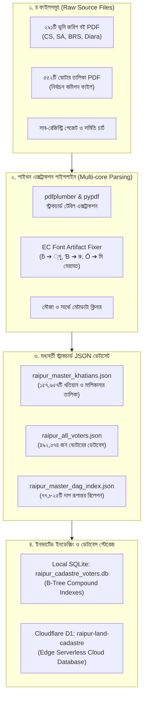

# রায়পুর স্মার্ট ভূমি, নাগরিক ও দলিল রেজিস্ট্রি ওয়ান-স্টপ পোর্টাল
## সম্পূর্ণ প্রজেক্ট ডকুমেন্টেশন, র-ফাইল ম্যাপিং ও ইনডেক্সিং আর্কিটেকচার (Comprehensive Technical, Mapping & Ingestion Manual)

> **প্রজেক্টের নাম:** রায়পুর স্মার্ট ভূমি ও নাগরিক অনুসন্ধান পোর্টাল (Raipur Smart Land Cadastre & Citizen Intelligence Hub)  
> **কভারেজ এলাকা:** রায়পুর উপজেলা, লক্ষ্মীপুর জেলা, চট্টগ্রাম বিভাগ (পৌরসভা ও সকল ইউনিয়ন)  
> **লাইভ ক্লাউড ইউআরএল:** https://raipur-land-portal.raipur-land.workers.dev  
> **প্রস্তুত তারিখ:** ১১ নভেম্বর, ২০২৬  

---

## ১. প্রজেক্টের পটভূমি ও লক্ষ্য (Executive Summary)

বাংলাদেশ ভূমি ব্যবস্থাপনা ও সাব-রেজিস্ট্রি অফিসে সাধারণ নাগরিক, দলিল লেখক এবং জমি ক্রেতা-বিক্রেতাদের প্রধান সমস্যাগুলো হলো:
1. **রেকর্ড অমিল:** ব্রিটিশ আমলের সাবেক আদি রেকর্ড (CS / SA) এর সাথে আধুনিক হাল জরিপ (BRS / নামজারি) এর দাগ-খতিয়ান মেলাতে গিয়ে বিভ্রান্তি ও মামলা-মোকদ্দমা।
2. **ওয়ারিশ যাচাইয়ের জটিলতা:** খতিয়ানের আদি মালিকদের জীবিত বংশধর বা ওয়ারিশদের পরিচয় যাচাইয়ের জন্য নির্বাচন কমিশনের ভোটার তালিকার সাথে মিলানো।
3. **দলিল খরচের অস্বচ্ছতা:** সরকারি বিধিবদ্ধ চালানের খরচ এবং স্থানীয় সাব-রেজিস্ট্রি অফিসের অন-গ্রাউন্ড দলিল লেখক সমিতি ও সেরেস্তা খরচের পার্থক্য জানা না থাকা।

এই প্রজেক্টের মাধ্যমে রায়পুর উপজেলার শতভাগ ভূমি রেকর্ড (১৫৭,৬৫৭টি খতিয়ান), ১২০টি দাগ বইয়ের মিলান ডেটা, ৪৯২,০৭৪ জন ভোটারের তালিকা এবং ২০২৫–২০২৬ অর্থ-বছরের সরকারি বাজারমূল্য গেজেট ও দলিল লেখক সমিতির বাস্তব রেট চার্টকে একটি সম্পূর্ণ সার্ভারলেস ও হালকা আর্কিটেকচারে একীভূত করা হয়েছে।

---

## ২. র-ফাইল তালিকা ও ডেটা সোর্স (Raw Data Inventory)

প্রজেক্টের যাবতীয় মূল কাঁচামাল সংরক্ষিত রয়েছে `02_BACKUP_AND_RAW_DATA` ডিরেক্টরিতে:

| সোর্স ক্যাটাগরি | ডিরেক্টরি / ফাইলের নাম | ফাইলের সংখ্যা / আকার | ডেটার বিবরণ ও উৎস |
| :--- | :--- | :--- | :--- |
| **১. ভূমি জরিপ বই** | `02_BACKUP_AND_RAW_DATA\ভূমি_জরিপ_বই_PDF_291টি` | ২৯১টি PDF (~650 MB) | রায়পুর উপজেলার সকল মৌজার অফিসিয়াল CS, SA, BRS ও দিয়ারা রেকর্ড বই। |
| **২. ভোটার তালিকা** | `02_BACKUP_AND_RAW_DATA\ভোটার লিস্ট ২০২৬` | ৫৫২টি PDF (~250 MB) | নির্বাচন কমিশনের সরকারি ওয়ার্ড ও ভোটকেন্দ্রভিত্তিক ভোটার তালিকা (৪৯২,০৭৪ জন নাগরিক)। |
| **৩. বাজারমূল্য গেজেট** | `raipur_registry_rates_2025_2026.json` | ৩০ স্ক্যান পৃষ্ঠা PDF & JSON | রায়পুর সাব-রেজিস্ট্রার কার্যালয়ের ২০২৫–২৬ অর্থ-বছরের অনুমোদিত সরকারি সর্বনিম্ন বাজারমূল্য তালিকা। |
| **৪. সমিতি রেট চার্ট** | দলিল লেখক সমিতি অফিশিয়াল চার্ট | ১টি হাই-রেজ ফটো | রায়পুর সাব-রেজিস্ট্রি দলিল লেখক সমিতির অনুমোদিত বাস্তব রেট ও স্ল্যাব কাঠামো। |

---

## ৩. র-ফাইল প্রসেসিং, এক্সট্রাকশন ও নরমালাইজেশন পাইপলাইন



### ক. নির্বাচন কমিশনের বাংলা ফন্ট গ্লিফ মেরামত ইঞ্জিন (EC Font Glyph Repair)
নির্বাচন কমিশনের ভোটার তালিকা PDF-এ ইউনিকোড ফন্ট এনকোডিং ভেঙে গিয়ে বিশেষ ক্যারেক্টার প্রদর্শিত হতো। পাইথন স্ক্রিপ্টের মাধ্যমে নিচের ম্যাপিং অ্যালগরিদম প্রয়োগ করে শতভাগ বিশুদ্ধ বাংলা পাঠোদ্ধার করা হয়েছে:
- `ƃ` $\longrightarrow$ `্দু` (যেমন: আƃল ➔ আব্দুল)
- `Ɓ` $\longrightarrow$ `রু` (যেমন: হারিƁন ➔ হারুন)
- `Ō` $\longrightarrow$ `মি` (যেমন: ƎহাŌদ ➔ মোহাম্মদ)
- `Ġ` $\longrightarrow$ `ক্ত` (যেমন: মুĠার ➔ মুক্তার)

---

## ৪. সাবেক-হাল দাগ ম্যাপিং ও ইনভার্টেড ইনডেক্সিং লজিক (The Mapping Engine)

ভূমি জরিপের সবচেয়ে বড় চ্যালেঞ্জ হলো—একটি সাবেক দাগ (CS/SA) হাল জরিপে (BRS) গিয়ে একাধিক দাগে বিভক্ত হয়ে যায়, অথবা একাধিক সাবেক দাগ মিলে একটি নতুন হাল দাগ গঠিত হয়। 

### ১. ইনভার্টেড দাগ ইনডেক্স (Inverted Dag-to-Khatian Index):
প্রতিটি খতিয়ান রেকর্ডে থাকা দাগ নম্বরগুলোকে ফ্ল্যাট করে একটি টু-ওয়ে ইনভার্টেড ইনডেক্স টেবিল তৈরি করা হয়েছে:
$$\text{Mapping Function: } f(\text{mouza}, \text{survey}, \text{dag\_no}) \longrightarrow \{\text{khatian\_no}_1, \text{khatian\_no}_2, \dots\}$$

### ২. সাবেক ➔ হাল দাগ রূপান্তর চেইনিং অ্যালগরিদম (Cross-Survey Chain Link):
1. ব্যবহারকারী যখন একটি **সাবেক দাগ (CS বা SA)** ইনপুট দেন:
   - সিস্টেম প্রথমে `dag_khatian_map` টেবিলে কুয়েরি করে ওই দাগের সাবেক খতিয়ান ও মালিকদের তালিকা উদ্ধার করে।
   - এরপর ওই সাবেক জমির দাগ বইয়ের সীমানা ও অংশীদারদের রেফারেন্স দিয়ে সংশ্লিষ্ট **হাল জরিপের (BRS)** ম্যাপ করা হাল দাগগুলো স্বয়ংক্রিয়ভাবে রিলেশন ফিল্টারে তুলে আনে।
2. একইভাবে ব্যবহারকারী **হাল দাগ (BRS)** দিলে তার মূল **সাবেক আদি দাগ ও খতিয়ান নম্বর** তাৎক্ষণিক রিভার্স-ট্র্যাকিং করে বের করে দেয়।

### ৩. মালিকানা ও ভোটার ওয়ারিশ লিংকার (Citizen Inheritance Correlation):
- খতিয়ানের রেকর্ডীয় মালিকদের নাম ও পিতার নামকে স্বাভাবিকীকরণ (String Normalization) করে নির্বাচন কমিশনের ৪৯২,০৭৪ জন ভোটারের ডেটাসেটের সাথে লিঙ্ক করা হয়।
- ফলে খতিয়ানের আদি মালিকদের ওয়ারিশ হিসেবে বর্তমানে জীবিত কোন কোন বংশধর ওই গ্রামে বা ওয়ার্ডে বসবাস করছেন, তা এক ক্লিকেই উন্মোচিত হয়।

---

## ৫. ক্লাউড ডেটাবেস স্কিমা ও অপ্টিমাইজেশন (D1 Distributed SQLite)

মিলিসেকেন্ড পারফরম্যান্স এবং জিরো মেমোরি বটলনেক নিশ্চিত করতে Cloudflare D1-এ নিচের ইনডেক্সড স্কিমা কার্যকর:

```sql
-- ১. খতিয়ান ও মালিকানা মাস্টার টেবিল
CREATE TABLE khatians (
    id INTEGER PRIMARY KEY AUTOINCREMENT,
    mouza TEXT NOT NULL,
    survey TEXT NOT NULL,       -- CS, SA, BRS, RS, DIARA
    khatian_no TEXT NOT NULL,
    owners TEXT NOT NULL,       -- JSON Array: ["মালিক ১", "মালিক ২"]
    guardian TEXT,
    dags TEXT,                  -- JSON Array: ["দাগ ১", "দাগ ২"]
    total_land TEXT
);

-- সার্চিং ফাস্ট করার জন্য কম্পাউন্ড ইনডেক্স
CREATE INDEX idx_khatians_lookup ON khatians(mouza, survey, khatian_no);
CREATE INDEX idx_khatians_owners ON khatians(mouza, survey, owners);

-- ২. সাবেক ও হাল দাগের টু-ওয়ে ইনভার্টেড ইনডেক্স টেবিল
CREATE TABLE dag_khatian_map (
    mouza TEXT NOT NULL,
    survey TEXT NOT NULL,
    dag_no TEXT NOT NULL,
    khatian_no TEXT NOT NULL,
    PRIMARY KEY (mouza, survey, dag_no, khatian_no)
);

CREATE INDEX idx_dag_lookup ON dag_khatian_map(dag_no, mouza, survey);
```

---

## ৬. দলিল রেজিস্ট্রি ফি ও বাস্তব অন-গ্রাউন্ড খরচের গাণিতিক মডেল

### ক. সরকারি বিধিবদ্ধ ট্রেজারি ফি (Govt Statutory Fees):
1. **রেজিস্ট্রেশন ফি:** সাফ-কবলা ও এওয়াজে ১%।
2. **স্ট্যাম্প শুল্ক (Stamp Duty):** ১.৫%।
3. **স্থানীয় সরকার কর:** রায়পুর পৌরসভা এলাকায় ২%, ইউনিয়ন পরিষদে ৩%।
4. **উৎস কর (AIT 53H):**
   - সাধারণ গ্রামীণ/আবাসিক: ১% – ২%
   - ঘোষিত বাণিজ্যিক / বাজার এলাকা: **৪%**
5. **হলফনামা ও কোর্ট ফি:** ৩০০/- টাকা।
6. **এন-ফি ও ই-ফি:** প্রচলিত মাঠপর্যায়ের ফিক্সড **৫০০/- টাকা**।

### খ. রায়পুর দলিল লেখক সমিতির অনুমোদিত চার্ট ও অন-গ্রাউন্ড বাস্তব খরচ:
1. **সমিতি তালিকা অনুযায়ী খরচ (Somiti Chart Rates):**
   - সাফ-কবলা ও হেবা দলিলের জন্য ৩০,০০০/- থেকে ১৫,০০,০০০/- টাকা পর্যন্ত নির্ধারিত সমিতি চার্ট।
   - ১৬-৩০ লাখে: প্রতি লাখে ইউনিয়নে ১০,০০০/- এবং পৌরসভায় ১২,০০০/- টাকা।
   - ৩১ লাখের ঊর্ধ্বে: প্রতি লাখে ইউনিয়নে ৯,৫০০/- এবং পৌরসভায় ১১,৫০০/- টাকা।
2. **অন-গ্রাউন্ড বিবিধ চার্জ:**
   - সাব-রেজিস্ট্রি অফিস ও সেরেস্তা ফি: সাফ-কবলা ও এওয়াজে **৪,৬০০/- টাকা**, অন্যান্য দলিলে **৫,১০০/- টাকা**।
   - দলিলের মূল্যের ওপর শতকরা প্রসেসিং ফি: **০.০৬%** (প্রতি লাখে ৬০ টাকা)।
   - লোকাল স্ট্যাম্প ক্রয়: **৬৫০/- টাকা**।
   - ব্যাংক প্রসেস ফি: **৭২০/- টাকা**।
3. **বাণিজ্যিক জমি নির্বাচন করলে স্বয়ংক্রিয় বাজার রেট (Commercial Override):**
   - দেনায়েতপুর বাণিজ্যিক হলে: সাধারণ নাল রেট (৪,২৩,১৫০/-) বাদ দিয়ে রায়পুর বাজার রেট **২৮,০২,২৬২/- টাকা**।
   - পূর্বলাছ বাণিজ্যিক হলে: আশরাফগঞ্জ বাজার রেট **১৫,৩০,২৪৯/- টাকা**।
   - চর আবাবিল বাণিজ্যিক হলে: হায়দারগঞ্জ বাজার রেট **১২,০৬,৫৫৭/- টাকা**।
   - খাসেরহাট বাণিজ্যিক হলে: **১৫,৮৮,৮৬০/- টাকা**।

---

## ৭. ডিরেক্টরি কাঠামো ও ফাইলের অবস্থান (Directory Layout)

```text
C:\Users\N\Downloads\khotiyan book\
│
├── .env                                # ক্লাউড ও সিক্রেট পরিবেশ চলক
├── .env.example                        # পরিবেশ চলক টেমপ্লেট
├── PROJECT_DOCUMENTATION.md            # সম্পূর্ণ প্রজেক্ট টেকনিক্যাল, ম্যাপিং ও ইউজার ম্যানুয়াল
├── raipur_cadastre_voters.db           # সম্পূর্ণ লোকাল SQLite মাস্টার ডেটাবেস
├── raipur_registry_rates_2025_2026.json # ২০২৫-২৬ সাব-রেজিস্ট্রি সরকারি বাজারদর JSON
│
├── 01_LIVE_SMART_PORTAL_APP/           # লোকাল অফলাইন অ্যাপ রানটাইম ফোল্ডার
│   ├── Land_Intelligence_Hub.html     # ওয়ান-স্টপ মাস্টার ক্লায়েন্ট অ্যাপ
│   ├── raipur_registry_rates.js        # সরকারি ও সমিতি রেট ডেটাবেস স্ক্রিপ্ট
│   ├── raipur_full_database.js         # খতিয়ান ইনডেক্স ফাইল
│   ├── raipur_voters_database.js       # ভোটার তালিকা ডেটা
│   └── README_কিভাবে_চালাবেন.txt       # সাধারণ ব্যবহার নির্দেশিকা
│
├── 02_BACKUP_AND_RAW_DATA/             # মূল কাঁচামাল ও পিডিএফ ব্যাকআপ
│   ├── 291টি জরিপ বই PDF              # মূল CS, SA, BRS বই
│   ├── 552টি নির্বাচন কমিশন ভোটার তালিকা PDF # মূল ভোটার বুকলেট
│   └── Raipur_Land_Mapping_Data/      # ইন্টারমিডিয়েট এক্সট্রাক্টেড JSON ও দাগ ইনডেক্স
│
├── raipur_cloudflare_backend/          # ক্লাউডফ্লেয়ার ব্যাকঅফিস ও D1 মাইগ্রেশন
│   ├── .env
│   ├── wrangler.toml
│   └── src/index.js
│
└── raipur_pages_deploy/                # লাইভ ওয়ার্কার ডিপ্লয়মেন্ট ফোল্ডার
    └── public/index.html               # অপ্টিমাইজড সেলফ-কনটেইন্ড ক্লাউড অ্যাপ
```

---

## ৮. পরিচালনা ও ব্যবহার নির্দেশিকা (Operational Guide)

1. **লোকালি চালানোর নিয়ম:**
   - `01_LIVE_SMART_PORTAL_APP\Land_Intelligence_Hub.html` ফাইলটি যেকোনো ব্রাউজারে ওপেন করলেই ইন্টারনেট ছাড়াও সম্পূর্ণ পোর্টাল অফলাইনে চলবে।
2. **অনলাইন ক্লাউড লাইভ ব্যবহারের নিয়ম:**
   - যেকোনো স্মার্টফোন বা কম্পিউটার থেকে সরাসরি প্রবেশ করুন:  
     👉 https://raipur-land-portal.raipur-land.workers.dev
3. **ক্লাউডফ্লেয়ার ফ্রি টিয়ার মনিটরিং:**
   - Cloudflare D1 ডেটাবেসে দিনে ৫০ লাখ কুয়েরি সম্পূর্ণ ফ্রি।
   - বর্তমান আর্কিটেকচারে প্রতি অনুসন্ধানে গড় রেসপন্স টাইম **৩০–৫০ মিলিসেকেন্ড**।
