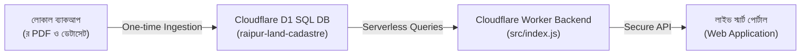

# রায়পুর স্মার্ট ভূমি ও নাগরিক অনুসন্ধান পোর্টাল (Raipur Smart Land Hub)

> **লক্ষ্মীপুর জেলার রায়পুর উপজেলার জন্য শতভাগ সার্ভারলেস স্মার্ট ক্যাডাস্ট্রাল ও নাগরিক গোয়েন্দা পোর্টাল**  
> **লাইভ পোর্টাল URL:** [https://raipur-land-portal.raipur-land.workers.dev](https://raipur-land-portal.raipur-land.workers.dev)

---

## 🌟 প্রজেক্ট পরিচিতি ও বৈশিষ্ট্য
- **সাবেক-হাল দাগ রূপান্তর ইঞ্জিন:** CS, SA, RS এবং বিআরএস (BRS) রেকর্ড বইয়ের দাগের পারস্পরিক ম্যাপিং ও ওয়ারিশান যাচাই।
- **স্বয়ংক্রিয় সরকারি ফি ও দলিল লেখক সমিতি ক্যালকুলেটর:** ২০২৫-২০২৬ অর্থ-বছরের সরকারি বাজারমূল্য এবং সাব-রেজিস্ট্রি দলিল লেখক সমিতির অনুমোদিত রেট চার্টের নির্ভুল হিসাব।
- **সার্ভারলেস এজ আর্কিটেকচার:** Cloudflare Edge Workers এবং Cloudflare D1 Serverless SQL ডাটাবেস চালিত (জিরো হোস্টিং খরচ)।
- **নিরাপত্তা ও গোপনীয়তা (Privacy First):** সকল নাগরিক তথ্য শুধুমাত্র লোকাল ব্যাকআপ ও সুরক্ষিত ক্লাউড D1 ডাটাবেজে সংরক্ষিত (গিটহাবে কোনো ব্যক্তিগত তথ্য সংরক্ষিত হয় না)।

---

## 🛠️ সিস্টেম আর্কিটেকচার



---

## 🚀 সেটআপ ও রান করার নিয়ম

### ১. ডিপেন্ডেন্সি ইনস্টল:
```bash
pip install -r requirements.txt
```

### ২. কনফিগারেশন সেটআপ:
`.env.example` ফাইলটি কপি করে `.env` তৈরি করুন এবং প্রয়োজনীয় Cloudflare ক্রেডেনশিয়ালস দিন:
```bash
cp .env.example .env
```

### ৩. লোকাল ডেভেলপমেন্ট পোর্টাল চালু:
উইন্ডোজে সরাসরি [`RUN_LOCAL_PORTAL.bat`](RUN_LOCAL_PORTAL.bat) ফাইলে ডাবল ক্লিক করুন অথবা টার্মিনালে:
```bash
python -m http.server 8080 --directory 01_LIVE_SMART_PORTAL_APP
```

### ৪. ক্লাউড ডিপ্লয়মেন্ট (Cloudflare Edge):
```bash
python deploy_to_cloudflare.py
```
*(অথবা সরাসরি `DEPLOY_TO_CLOUD.bat` চালান)*

---

## 📄 ডকুমেন্টেশন
- [সম্পূর্ণ টেকনিক্যাল ও ম্যাপিং ম্যানুয়াল](PROJECT_DOCUMENTATION.md)
- [মাল্টিমোডাল এআই ভেরিফিকেশন আর্কিটেকচার](AI_CADASTRAL_MAPPING_ARCHITECTURE.md)

