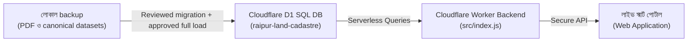

# রায়পুর স্মার্ট ভূমি ও নাগরিক অনুসন্ধান পোর্টাল (Raipur Smart Land Hub)

> **রায়পুর উপজেলার land-record portal — local datasets ও Cloudflare API-সহ; production D1 coverage সম্পূর্ণ কিনা deploy-এর আগে যাচাই করুন।**  
> **লাইভ পোর্টাল URL:** [https://raipur-land-portal.raipur-land.workers.dev](https://raipur-land-portal.raipur-land.workers.dev)

---

## 🌟 প্রজেক্ট পরিচিতি ও বৈশিষ্ট্য
- **Land lookup:** survey filter ও একই survey-তে dag→khatian lookup; প্রমাণ-সমর্থিত cross-survey parcel lineage বা আইনি ওয়ারিশ যাচাই এখনো নেই।
- **স্বয়ংক্রিয় সরকারি ফি ও দলিল লেখক সমিতি ক্যালকুলেটর:** ২০২৫-২০২৬ অর্থ-বছরের সরকারি বাজারমূল্য এবং সাব-রেজিস্ট্রি দলিল লেখক সমিতির অনুমোদিত রেট চার্টের নির্ভুল হিসাব।
- **Cloud architecture:** Cloudflare Worker/D1 API আছে; সম্পূর্ণ source coverage যাচাই না হওয়া পর্যন্ত production D1-কে complete বলা যাবে না।
- **গোপনীয়তা:** voter data ব্যক্তিগত। বড় land/voter JS data files শুধু local portal-এ ব্যবহার করুন; cloud build API-only। Voter API-তে active approved deed-writer/admin access প্রয়োজন।

---

## 🛠️ সিস্টেম আর্কিটেকচার



---

## 🚀 সেটআপ ও রান করার নিয়ম

### ১. ডিপেন্ডেন্সি ইনস্টল:
```bash
pip install -r requirements.txt
```

### ২. কনফিগারেশন সেটআপ:
`.env.example` ফাইলটি কপি করে `.env` তৈরি করুন এবং প্রয়োজনীয় Cloudflare ক্রেডেনশিয়ালস দিন:
```bash
cp .env.example .env
```

### ৩. Local SQLite তৈরি (partition files থেকে):
```bash
python partition_datasets.py
python create_sqlite_db.py
```
আগের DB থাকলে script overwrite করবে না; backup রেখে প্রতিস্থাপনের জন্য স্পষ্টভাবে `--replace` দিন। Unknown survey label auto-correct করা হয় না।

### ৪. লোকাল ডেভেলপমেন্ট পোর্টাল চালু:
উইন্ডোজে সরাসরি [`RUN_LOCAL_PORTAL.bat`](RUN_LOCAL_PORTAL.bat) ফাইলে ডাবল ক্লিক করুন অথবা টার্মিনালে:
```bash
python -m http.server 8080 --bind 127.0.0.1 --directory 01_LIVE_SMART_PORTAL_APP
```

### ৫. ক্লাউড ডিপ্লয়মেন্ট (Cloudflare Edge):
```bash
cd raipur_cloudflare_backend
npx wrangler d1 migrations apply raipur-land-cadastre --remote
cd ..
python deploy_to_cloudflare.py --apply
```
*(অথবা সরাসরি `DEPLOY_TO_CLOUD.bat` চালান)*
প্রথমে Cloudflare D1-এর backup নিন, migration SQL review করুন, তারপর migration command দিন। Cloud deploy-এর আগে `.env`/CI-তে unique random `TOKEN_SECRET` (কমপক্ষে 32 bytes), Cloudflare credentials, D1 migration verification, এবং approved data-load plan প্রস্তুত থাকতে হবে। Deployment script schema ও expected row-count preflight ব্যর্থ হলে upload বন্ধ করবে; expected count বদলালে duplicate/dedup policy লিখিতভাবে অনুমোদন করুন। Script চালানোর আগে `python deploy_to_cloudflare.py` শুধু local bundle build করবে; upload করবে না।

---

## 📄 ডকুমেন্টেশন
- [সম্পূর্ণ টেকনিক্যাল ও ম্যাপিং ম্যানুয়াল](PROJECT_DOCUMENTATION.md)
- [মাল্টিমোডাল এআই ভেরিফিকেশন আর্কিটেকচার](AI_CADASTRAL_MAPPING_ARCHITECTURE.md)
